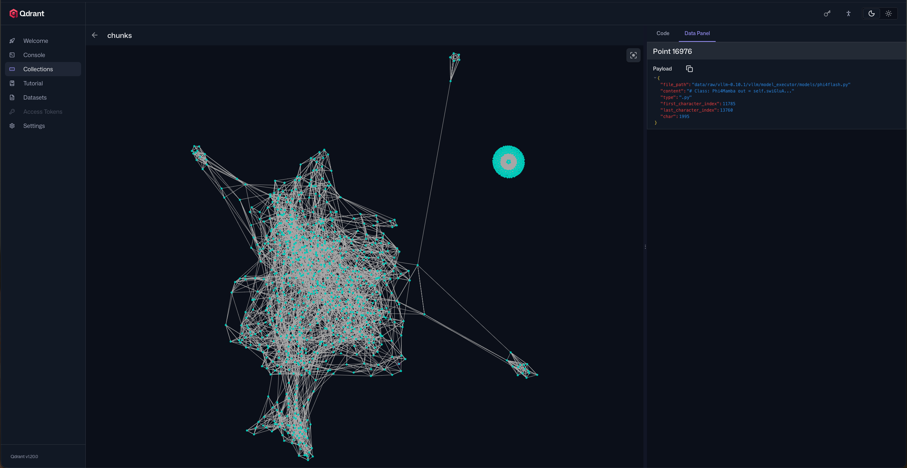

<div align="center">

# 🔎 RAG — Ask Questions about Your Docs

**BM25, vector or hybrid search over your files, with optional query rewrite and reranking,
served by vLLM or a local Ollama.**


</div>

---

## ⚙️ Setup

### Install

Requirements: Python ≥ 3.10, [`uv`](https://docs.astral.sh/uv/), [Docker](https://docs.docker.com/get-docker/)
(Qdrant, for `embedding` / `hybrid`), and a backend: [Ollama](https://ollama.com) or [vLLM](https://docs.vllm.ai).

```bash
git clone git@github.com:ynsz-66/RAG.git rag && cd rag
make install       # uv sync
cp .env.example .env
make up            # Qdrant container (make down to stop it)
```

### `LLM=ollama`

```bash
ollama serve
ollama pull qwen3:8b         # chat model (answer, rewrite)
ollama pull bge-m3           # embedding model
```

The reranker runs locally with [fastembed](https://github.com/qdrant/fastembed) and downloads its model on first use.

The models above are only defaults: set any model you have pulled in the variables below
(any [fastembed](https://qdrant.github.io/fastembed/examples/Supported_Models/) cross-encoder for `RERANKER_MODEL`).

| Variable         | Default                   | Used for                        |
|------------------|---------------------------|---------------------------------|
| `OLLAMA_HOST`    | `http://localhost:11434`  | chat (answer, rewrite)          |
| `OLLAMA_MODEL`   | `qwen3:8b`                | chat model                      |
| `REWRITE_MODEL`  | `OLLAMA_MODEL`            | chat model for the rewrite only |
| `EMBED_HOST`     | `http://localhost:11434`  | embeddings                      |
| `EMBED_MODEL`    | `BGE-M3`                  | embedding model                 |
| `RERANKER_MODEL` | `BAAI/bge-reranker-v2-m3` | fastembed cross-encoder         |

### `LLM=vllm` *(default)*

One server per model, on any GPU machine; `vllm serve` downloads the model on first start:

```bash
vllm serve Qwen/Qwen3-8B-AWQ       --port 8000 --api-key <key> \
           --default-chat-template-kwargs '{"enable_thinking": false}'   # chat
vllm serve BAAI/bge-m3             --port 8001 --api-key <key> --runner pooling   # embeddings
vllm serve BAAI/bge-reranker-v2-m3 --port 8002 --api-key <key> --runner pooling   # reranker
```

These models are only defaults: serve any model vLLM supports, then set the same name in `VLLM_*_MODEL`
(it must match the name given to `vllm serve`).

| Variable            | Default                    | Used for                    |
|---------------------|----------------------------|-----------------------------|
| `VLLM_API_KEY`      | `EMPTY`                    | same value as `--api-key`   |
| `VLLM_LLM_URL`      | `http://localhost:8000/v1` | chat, **with** `/v1`        |
| `VLLM_LLM_MODEL`    | `Qwen/Qwen3-8B-AWQ`        | chat model                  |
| `VLLM_EMBED_URL`    | `http://localhost:8001/v1` | embeddings, **with** `/v1`  |
| `VLLM_EMBED_MODEL`  | `BAAI/bge-m3`              | embedding model             |
| `VLLM_RERANK_URL`   | `http://localhost:8002`    | reranker, **without** `/v1` |
| `VLLM_RERANK_MODEL` | `BAAI/bge-reranker-v2-m3`  | reranker model              |

Use the machine's address instead of `localhost` if the servers run elsewhere, and always set `--api-key` if they are reachable from the internet.

Changing the embedding model changes the vectors: re-run `make index` for `embedding` / `hybrid`.

### Other settings

| Variable                   | Default                 | Description                                              |
|----------------------------|-------------------------|----------------------------------------------------------|
| `BM25_STEMMER_LANG`        | `english`               | Majority language of the corpus (any Snowball language); re-index after changing it |
| `QDRANT_URL`               | `http://localhost:6333` | Qdrant server                                            |
| `QDRANT_COLLECTION`        | `chunks`                | Collection of the `embedding` method                     |
| `QDRANT_HYBRID_COLLECTION` | `chunks_hybrid`         | Collection of the `hybrid` method                        |
| `RERANK_CANDIDATES`        | `50`                    | Candidates fetched before reranking                      |
| `EMBED_QUERY_INSTRUCT`     | *(empty)*               | Query instruction for instruction-tuned embedders (e.g. Qwen3-Embedding) |

The Qdrant dashboard is at <http://localhost:6333/dashboard> (data in `qdrant_storage/`, deleted by `make fclean`):

<div align="center">
  
</div>

## 🚀 Usage

```bash
make index    [RAW=path/] [METHOD=bm25|embedding|hybrid] [LLM=vllm|ollama]                      # chunk + index a folder
make retrieve Q="your question" [K=10] [METHOD=...] [RERANKER=True] [REWRITE=True]             # print the top-K sources
make answer   Q="your question" [K=10] [KEEP=3] [METHOD=...] [RERANKER=True] [REWRITE=True]    # answer from the top KEEP sources
```

Index once (again after changing the corpus or the backend), then query as many times as you want.
Each target wraps `uv run python -m src <index|retrieve|answer> ...`. Example:

```bash
make index    METHOD=hybrid
make retrieve Q="How do I load a LoRA adapter?" METHOD=hybrid RERANKER=True
make answer   Q="How do I load a LoRA adapter?" METHOD=hybrid RERANKER=True
```


### Make commands

| Command            | Description                                              |
|--------------------|----------------------------------------------------------|
| `make help` / `make`        | List all targets and their variables                     |
| `make install`     | Install dependencies (`uv sync`)                         |
| `make up` / `down` | Start / stop the Qdrant container                        |
| `make index`       | Index `RAW` with `METHOD`                                |
| `make retrieve`    | Top-`K` chunks for `Q`                                   |
| `make answer`      | LLM answer for `Q`                                       |
| `make lint`        | flake8 + mypy                                            |
| `make clean`       | Stop Qdrant, remove venv and caches                      |
| `make fclean`      | `clean` + delete the Qdrant storage, BM25 index, chunks  |


## How it works

```
                                    ┌─ bm25 ──────▶ BM25 index (files on disk)
 docs folder ──▶ chunking ──▶ index ┤
                                    ├─ embedding ─▶ embeddings ──▶ Qdrant
                                    └─ hybrid ────▶ embeddings + BM25 text index ──▶ Qdrant

 question ──▶ [rewrite] ──▶ same method ──▶ candidates ──▶ [rerank] ──▶ top-k chunks ──▶ LLM ──▶ answer
```

- `bm25` *(default)*: ranks chunks by shared keywords, exact on names and flags (`--max-model-len`).
- `embedding`: ranks chunks by meaning, with BGE-M3 vectors stored in Qdrant.
- `hybrid`: runs both searches in Qdrant and fuses the two rankings with RRF (Reciprocal Rank Fusion).
- `RERANKER=True`: a cross-encoder (`bge-reranker-v2-m3`) re-scores `RERANK_CANDIDATES` candidates and keeps the top-k.
- `REWRITE=True`: an LLM rewrites the question (keywords for BM25, a clear sentence for embeddings); the original is kept.

Files: `.md` (by headings), `.py` (by AST), `.pdf` (by page), `.txt` (by lines).
The answer is written in the question's language, **only** from the sources.

## Stack

[`bm25s`](https://github.com/xhluca/bm25s) · [Qdrant](https://qdrant.tech) · [vLLM](https://docs.vllm.ai) (`openai` client) ·
Ollama (`httpx`) · [`fastembed`](https://github.com/qdrant/fastembed) · `pydantic` · `pypdf` · `fire` · `python-dotenv`

## License

See [LICENSE](LICENSE).

## 📊 Evaluation

`evaluate` only measures **retrieval quality** (Recall@k of `retrieve`), not the answers.
The datasets in `datasets_public/` are used **only** for it: questions about
[vLLM](https://github.com/vllm-project/vllm) v0.10.1 (docs and code), each with its ground-truth sources
(file path + character range). `AnsweredQuestions_edited/` holds the same questions reworded to be vague, to test `REWRITE=True`.

```bash
make fetch-vllm        # the exact corpus the ground truth points to (data/raw/vllm-0.10.1/)
make index             # RAW defaults to it

DS=datasets_public/public/AnsweredQuestions/dataset_docs_public.json
make search-dataset DATASET_PATH=$DS SAVE_DIRECTORY=results/search                           # top-K sources per question
make evaluate STUDENT_ANSWER_PATH=results/search/dataset_docs_public.json DATASET_PATH=$DS   # Recall@1/3/5/K
```

`search-dataset` accepts the same `METHOD`, `LLM`, `K`, `RERANKER`, `REWRITE` as `retrieve`; use one `SAVE_DIRECTORY`
per configuration (outputs keep the input's file name). Only `AnsweredQuestions[_edited]/` work with `evaluate`.
A ground-truth source is **found** when a retrieved chunk of the same file overlaps at least 5 % of it;
Recall@k is the share found in the top-k, averaged over the questions.
`make answer-dataset STUDENT_SEARCH_RESULTS_PATH=... SAVE_DIRECTORY=...` can also add an LLM answer per question (not scored).
